<div dir="rtl">

# بازارک (Bazarak)

[English](README.md) | **فارسی**

یک بازارچه‌ی اینترنتی چندفروشنده که با Django 5.2 ساخته شده است.

> **پروژه‌ی آموزشی.** این پروژه یک پروژه‌ی درسیِ تک‌فروشگاهی (پروژه‌ی [«شاپ»](https://github.com/rogolsanamlo/django-online-store) که با پیروی از تدریس استاد
> مهدی عباسی نوشتم) را به بازارچه تبدیل می‌کند؛ در آن هر فروشگاه کالاهای یکسانِ کاتالوگ را با قیمت خودش
> می‌فروشد.

## نحوه‌ی کار

- هر کسی می‌تواند کل کاتالوگ را مرور و جستجو کند.
- برای ثبت سفارش، کاربر باید ثبت‌نام کند (یک `UserProfile` به‌طور خودکار ساخته می‌شود) و وارد شود.
- هر کاربر فقط **یک** فروشگاه می‌تواند داشته باشد (`Store` با کاربر رابطه‌ی یک‌به‌یک دارد). فروشگاه‌های جدید
  تا زمانی که ادمین تأیید نکند غیرفعال‌اند.
- ادمین **کالاهای** کاتالوگ را تعریف می‌کند (مثلاً «روغن پخت‌وپز»). فروشنده کالا را با **قیمت خودش** به
  فروشگاهش اضافه می‌کند (`StoreProduct`) و موجودی را از پنل فروشنده مدیریت می‌کند.
- هر سفارش فقط شامل کالاهای **یک فروشگاه** است.

## امکانات

- صفحه‌ی اصلی با بنر، گروه‌های محبوب و کالاهای «جدیدترین» / «ارزان‌ترین» با یک تب برای هر گروه اصلی
- گروه‌بندی کالا (گروه اصلی + زیرگروه)، برند، ویژگی‌ها و فیلتر (بازه‌ی قیمت، برند، فروشگاه)، مرتب‌سازی و جستجو
- مقایسه‌ی کالا، علاقه‌مندی‌ها، امتیازدهی و نظرها (با تأیید ادمین)
- سبد خرید مبتنی بر session، ثبت سفارش، سبدهای تخفیف و کوپن
- پرداخت آنلاین با زرین‌پال؛ ثبت‌نام و بازیابی رمز عبور با کد پیامکی (کاوه‌نگار)
- **پنل فروشنده:** مشخصات فروشگاه، کالاها و قیمت‌ها، سفارش‌ها، موجودی انبار، تحلیل فروش (نمودار و خروجی Excel)
- پنل ادمین فارسی ([راهنمای ادمین](docs/ADMIN_GUIDE.md))
- REST API (با Django REST framework و JWT)

## تصاویر محیط برنامه

رابط کاربری فارسی (راست‌به‌چپ) است. تصاویر با داده‌ی نمونه‌ی برنامه گرفته شده‌اند.

### فروشگاه

<table>
<tr><td width="50%">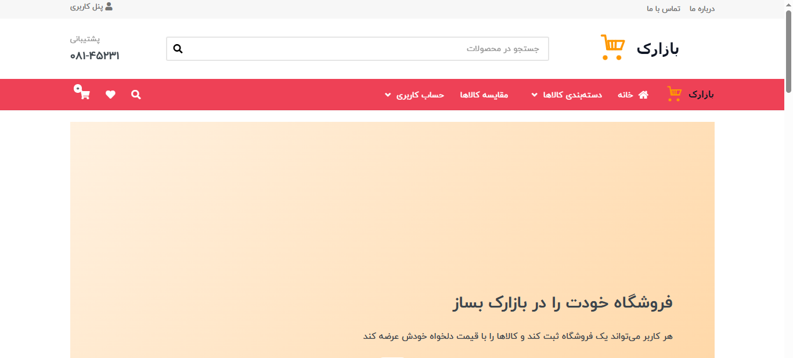<br><sub>صفحه‌ی اصلی: سربرگ، جستجو و بنر</sub></td><td width="50%">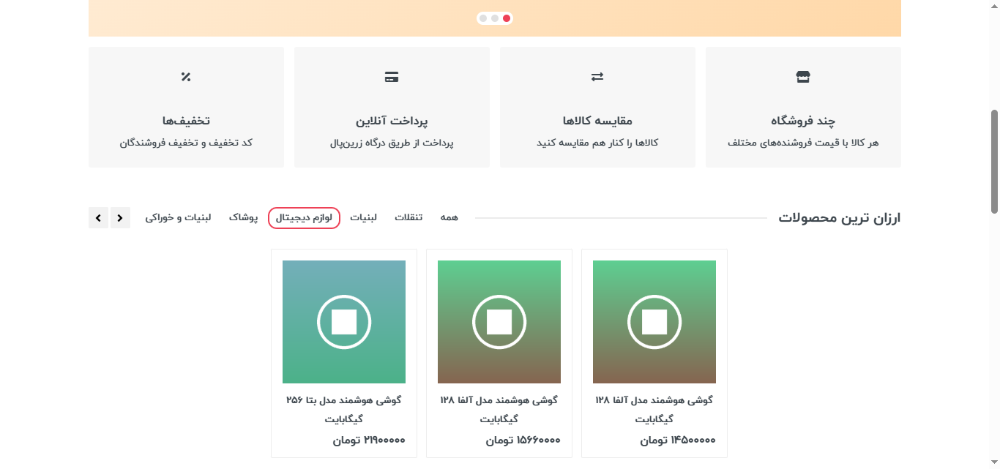<br><sub>صفحه‌ی اصلی: بخش «ارزان‌ترین» با فیلتر تب دسته‌بندی (بخش «جدیدترین» هم همین‌طور کار می‌کند)</sub></td></tr>
<tr><td width="50%">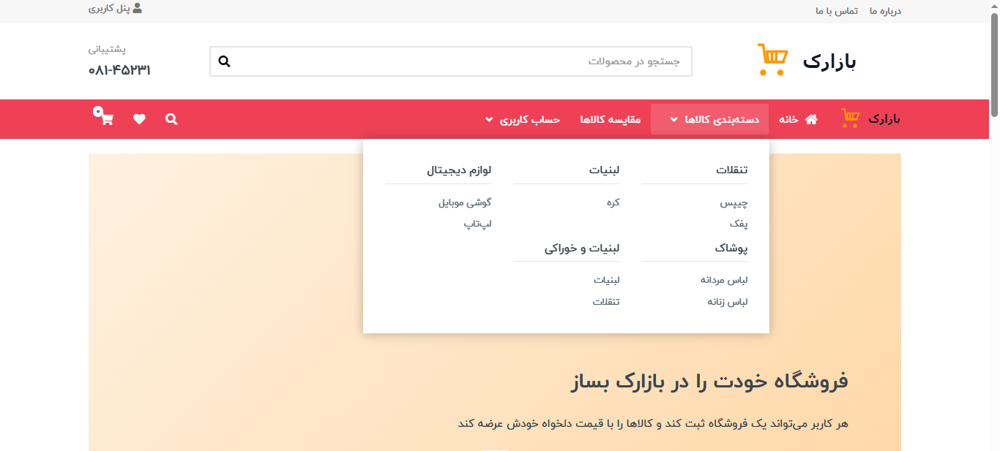<br><sub>منوی دسته‌بندی با گروه‌های اصلی و زیرگروه‌ها</sub></td><td width="50%">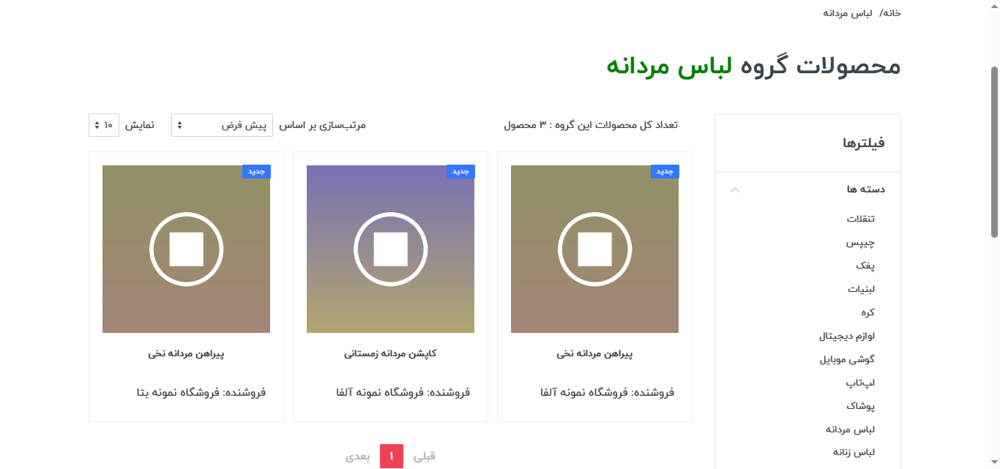<br><sub>کالاهای یک گروه، با مرتب‌سازی و تعداد نمایش</sub></td></tr>
<tr><td width="50%">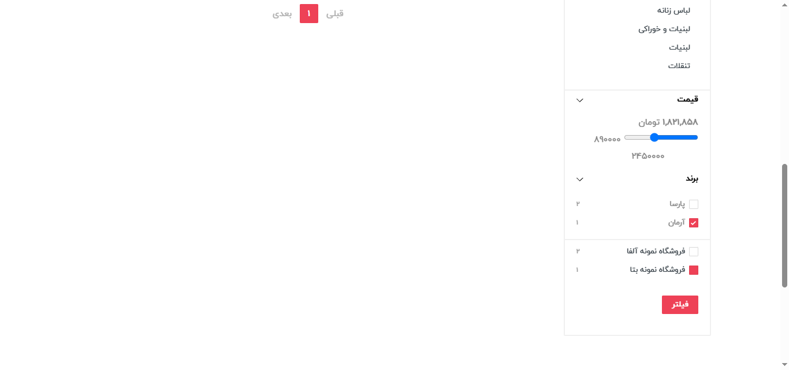<br><sub>فیلترها: بازه‌ی قیمت، برند و فروشگاه</sub></td><td width="50%">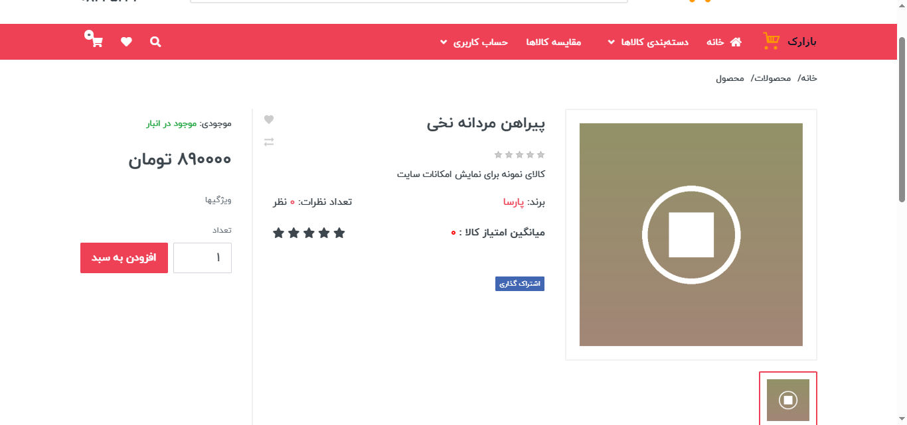<br><sub>صفحه‌ی کالا با قیمت، امتیاز، تب‌ها و افزودن به سبد</sub></td></tr>
<tr><td width="50%">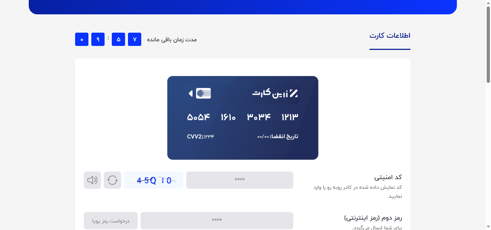<br><sub>صفحه‌ی پرداخت آزمایشی (sandbox) زرین‌پال (کارت نمایشی، بدون جابه‌جایی پول واقعی)</sub></td><td width="50%"></td></tr>
</table>

### حساب کاربری، علاقه‌مندی‌ها و سفارش‌ها

<table>
<tr><td width="50%">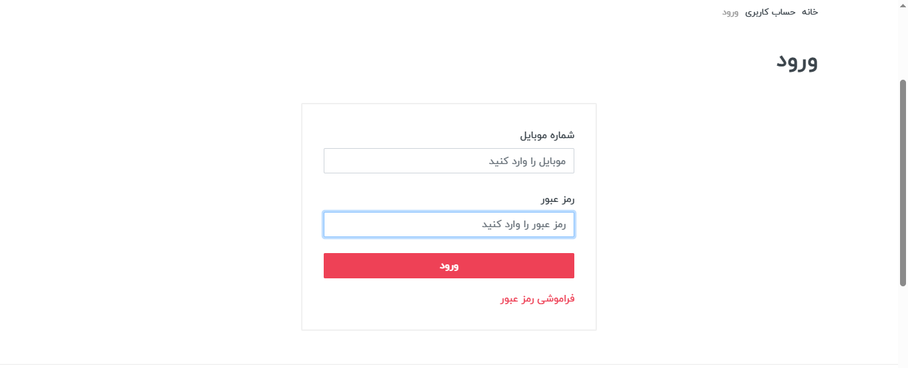<br><sub>صفحه‌ی ورود</sub></td><td width="50%">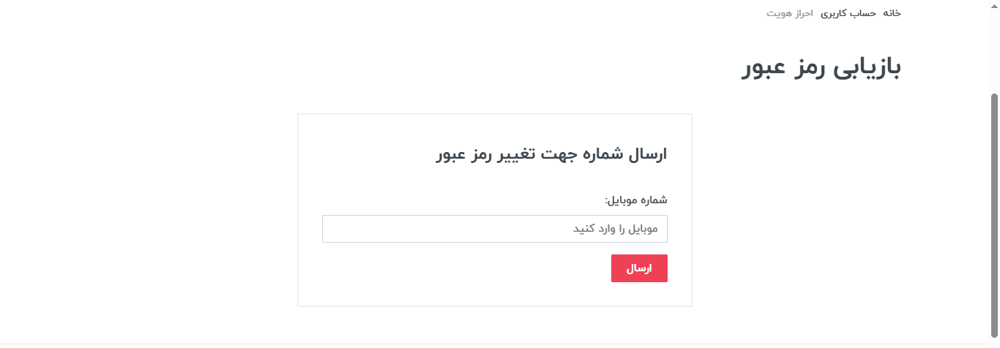<br><sub>بازیابی رمز عبور، مرحله‌ی ۱: وارد کردن شماره‌ی موبایل</sub></td></tr>
<tr><td width="50%">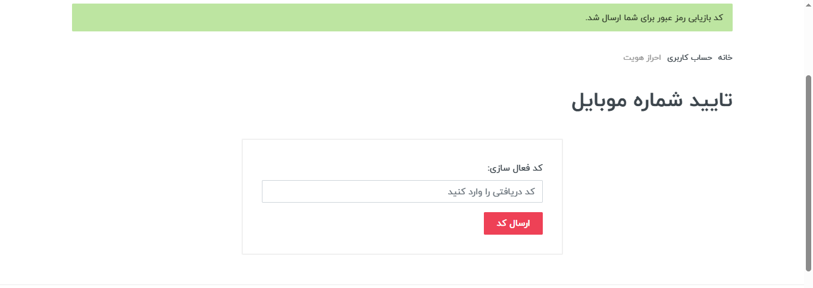<br><sub>بازیابی رمز عبور، مرحله‌ی ۲: وارد کردن کد ارسال‌شده با پیامک</sub></td><td width="50%">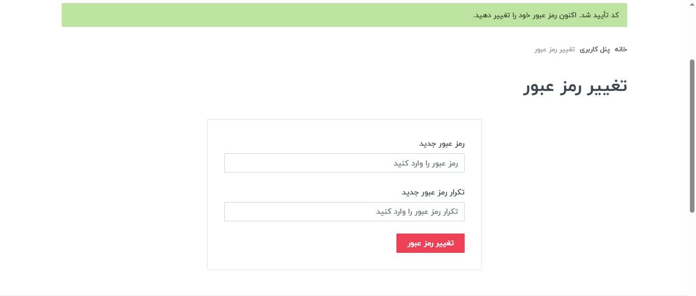<br><sub>بازیابی رمز عبور، مرحله‌ی ۳: انتخاب رمز عبور جدید</sub></td></tr>
<tr><td width="50%">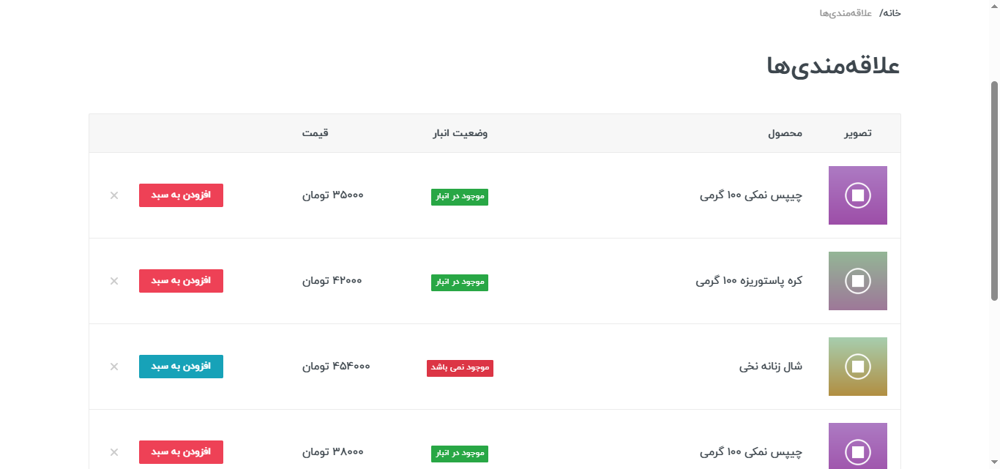<br><sub>فهرست علاقه‌مندی‌ها با وضعیت موجودی و دکمه‌ی افزودن به سبد</sub></td><td width="50%">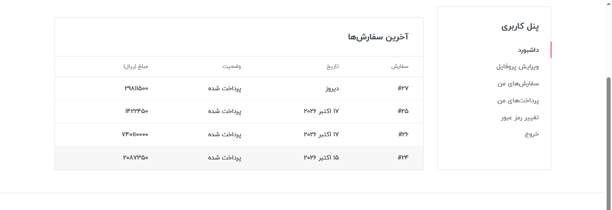<br><sub>پنل کاربری: آخرین سفارش‌ها</sub></td></tr>
<tr><td width="50%">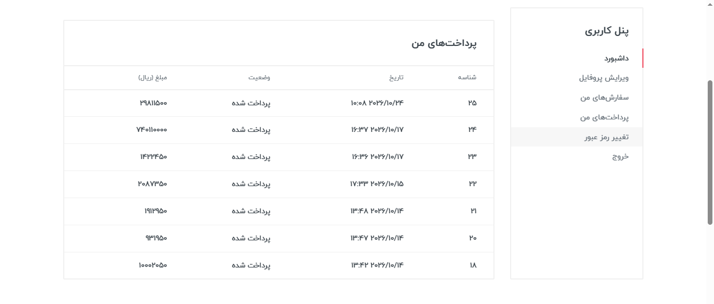<br><sub>پنل کاربری: پرداخت‌ها</sub></td><td width="50%"></td></tr>
</table>

### پنل فروشنده

<table>
<tr><td width="50%">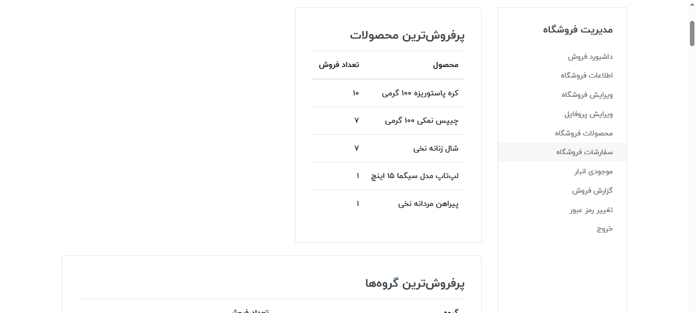<br><sub>داشبورد فروشنده: پرفروش‌ترین کالاها</sub></td><td width="50%">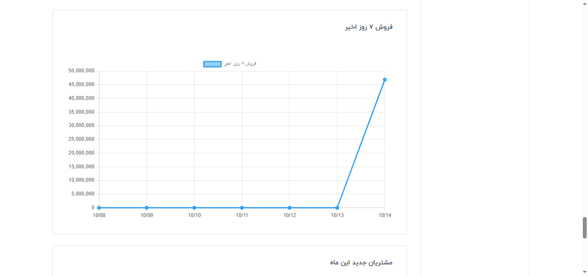<br><sub>داشبورد فروشنده: فروش ۷ روز اخیر</sub></td></tr>
<tr><td width="50%">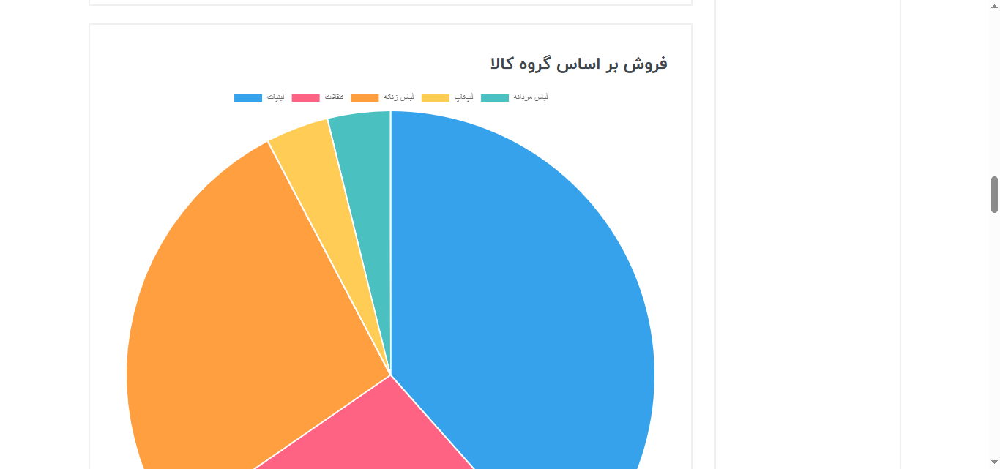<br><sub>داشبورد فروشنده: فروش بر اساس گروه کالا</sub></td><td width="50%">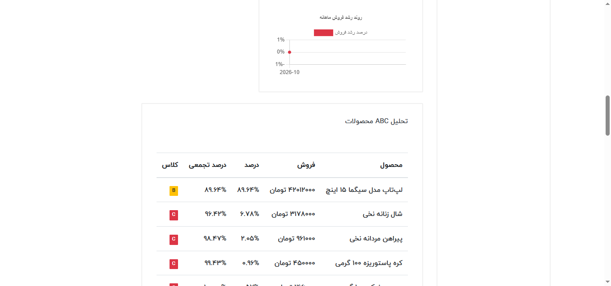<br><sub>گزارش‌ها: تحلیل ABC کالاها</sub></td></tr>
<tr><td width="50%">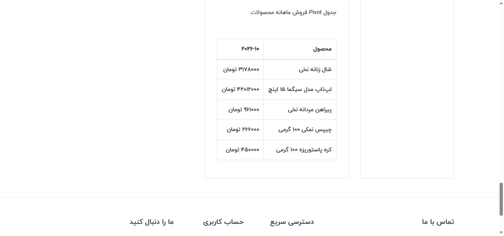<br><sub>گزارش‌ها: جدول Pivot فروش ماهانه</sub></td><td width="50%">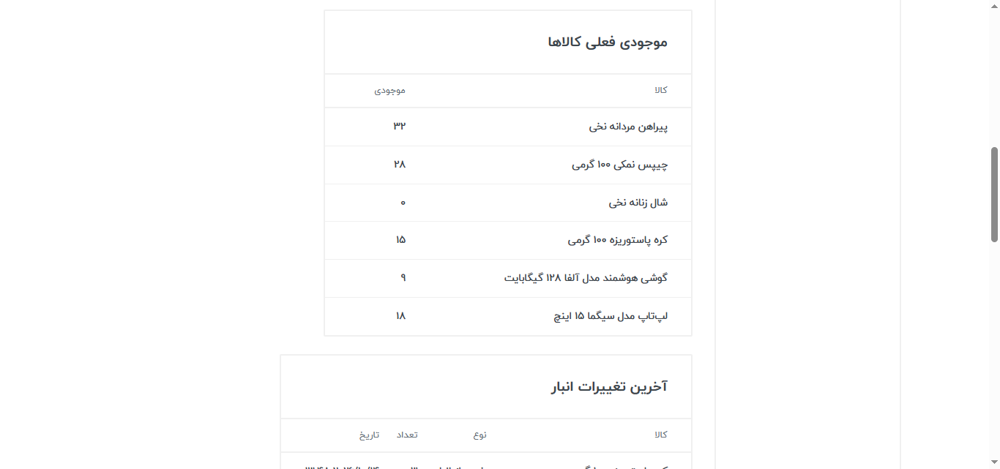<br><sub>صفحه‌ی انبار: موجودی فعلی هر کالا</sub></td></tr>
<tr><td width="50%">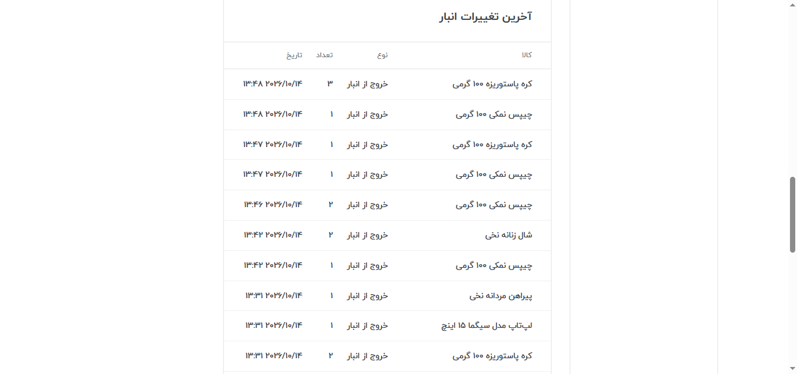<br><sub>صفحه‌ی انبار: آخرین تغییرات (ردیف‌های خروج بعد از هر پرداخت موفق خودکار ثبت می‌شوند)</sub></td><td width="50%">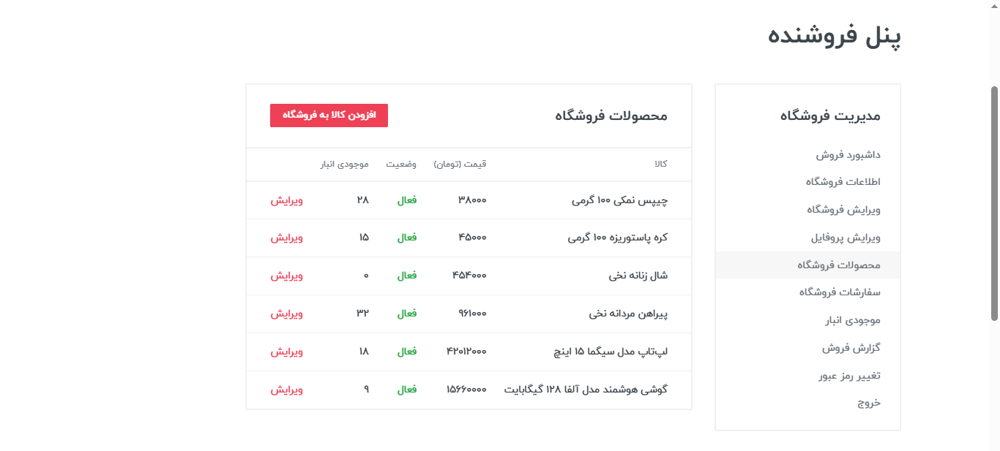<br><sub>کالاهای فروشگاه با قیمت، وضعیت و موجودی</sub></td></tr>
</table>

### پنل ادمین

<table>
<tr><td width="50%">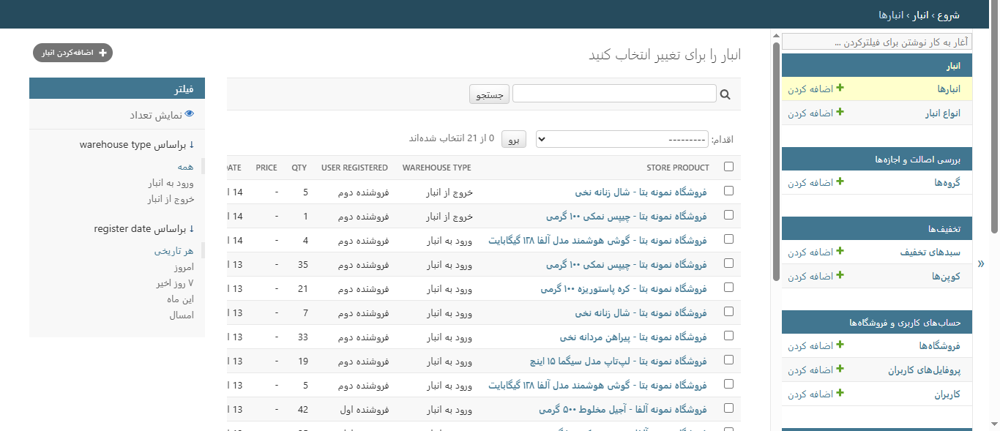<br><sub>ادمین: ردیف‌های انبار به تفکیک کالای فروشگاه (ورود / خروج)</sub></td><td width="50%"></td></tr>
</table>

## راه‌اندازی

پروژه با Python 3.12 توسعه یافته است (نسخه‌های قفل‌شده‌ی `numpy` و `pandas` به Python 3.11 یا بالاتر نیاز دارند).
اگر از SQLite استفاده نمی‌کنید (توضیح در ادامه)، یک سرور MySQL هم لازم است.

```bash
python -m venv venv
source venv/bin/activate        # Windows: venv\Scripts\activate
pip install -r requirements.txt
cp .env.example .env            # Windows: copy .env.example .env  (then edit the values)
python manage.py migrate
python manage.py createsuperuser
python manage.py runserver
```

برای یک نمونه‌ی آزمایشی بدون تنظیم پایگاه داده، در `.env` مقدار `DB_ENGINE=sqlite` را بگذارید. اگر
`KAVENEGAR_API_KEY` خالی باشد، کد تأیید پیامکی در کنسول چاپ می‌شود. پرداخت به‌طور پیش‌فرض با **sandbox**
زرین‌پال انجام می‌شود (`ZARINPAL_SANDBOX=True`) که هر شناسه‌ی پذیرنده‌ی ۳۶ نویسه‌ای را می‌پذیرد و به اینترنت
نیاز دارد؛ در محیط واقعی از شناسه‌ی پذیرنده‌ی واقعی و `ZARINPAL_SANDBOX=False` استفاده کنید. تا وقتی `DEBUG`
روشن است، دلیل فنی خطای درگاه در صفحه‌ی نتیجه‌ی پرداخت نمایش داده می‌شود.

اجرای تست‌ها (کاربر MySQL باید اجازه‌ی ساخت پایگاه داده‌ی تست را داشته باشد):

```bash
python manage.py test
```

## پرداخت

پرداخت با **sandbox** زرین‌پال انجام می‌شود، یعنی محیط آزمایشی درگاه: صفحه یک کارت نمایشی نشان می‌دهد و پول
واقعی جابه‌جا نمی‌شود؛ این روش برای یک پروژه‌ی نمونه‌کار معمول است. برای دریافت پرداخت واقعی به حساب پذیرنده‌ی
تأییدشده‌ی زرین‌پال و یک دامنه‌ی عمومی نیاز دارید، و سپس در `.env` تنظیم کنید:

```
ZARINPAL_MERCHANT_ID=<your real 36-character merchant id>
ZARINPAL_SANDBOX=False
ZARINPAL_CALLBACK_URL=https://your-domain/payments/verify/
```

مقدار `ZARINPAL_ACCESS_TOKEN` اختیاری است و فقط برای API گزارش‌گیریِ زرین‌پال لازم می‌شود.

## موجودی انبار

موجودی یک عدد ذخیره‌شده نیست، بلکه یک دفتر ثبت است. هر تغییر یک ردیف در `Warehouse` است (یک ردیف **ورودی** یا
**خروجی** برای یک `StoreProduct`) و موجودی برابر است با جمع ورودی‌ها منهای جمع خروجی‌ها
(`StoreProduct.get_number_in_warehouse()`).

- فروشنده ردیف‌ها را از صفحه‌ی انبار در پنل فروشنده اضافه می‌کند. قیمتی که روی ردیف ورودی وارد می‌شود، قیمت
  خرید است: گزارش سود برابر است با *فروش منهای هزینه‌ی خرید*؛ پس برای داشتن اعداد سود معنی‌دار، آن را وارد کنید.
- وقتی پرداخت زرین‌پال تأیید می‌شود، سفارش نهایی می‌شود و **برای هر قلم سفارش یک ردیف خروجی به‌طور خودکار
  ساخته می‌شود**. این کار فقط بار اولی که سفارش نهایی می‌شود انجام می‌شود؛ پس بازگشت تکراریِ درگاه (مثلاً
  رفرش صفحه‌ی نتیجه) هرگز موجودی را دو بار کم نمی‌کند. این ردیف‌ها به نام خریدار ثبت می‌شوند و در ادمین و در
  تاریخچه‌ی انبار فروشنده با عنوان «خروج از انبار» دیده می‌شوند.
- هنگام افزودن کالا به سبد یا ثبت سفارش، موجودی بررسی نمی‌شود (به
  [محدودیت‌های شناخته‌شده](#known-limitations) نگاه کنید).

## داده‌ی نمونه

برای داشتن سایتی پُر از داده، بدون وارد کردن دستی اطلاعات (فقط برای توسعه):

```bash
python manage.py seed_demo
```

این دستور ۳ گروه با ۶ زیرگروه، ۴ برند، ۱۲ کالا با تصویرهای تولیدشده و دو فروشگاه نمونه می‌سازد که کالاها را با
قیمت‌های متفاوت و موجودی عرضه می‌کنند. اجرای دوباره‌ی آن بی‌خطر است. برای امتحان پنل فروشنده، با یکی از
فروشنده‌های نمونه وارد شوید:

| فروشگاه | موبایل | رمز عبور |
|---|---|---|
| فروشگاه نمونه آلفا | `09120000001` | `demo12345` |
| فروشگاه نمونه بتا | `09120000002` | `demo12345` |

وقتی `DEBUG` خاموش باشد، این دستور اجرا نمی‌شود (مگر با `--force`)، چون حساب‌های نمونه رمز عبور شناخته‌شده
دارند.

## نخستین قدم‌ها بعد از نصب

1. وارد `/admin/` شوید و [راهنمای ادمین](docs/ADMIN_GUIDE.md) را دنبال کنید: یک گروه و یک زیرگروه، یک برند و
   یک کالا بسازید.
2. در سایت یک کاربر ثبت‌نام کنید، فروشگاه بسازید و بعد آن را در ادمین فعال کنید.
3. در پنل فروشنده، کالا را با قیمت به فروشگاه اضافه کنید.

## ساختار پروژه

| اپ | مسئولیت |
|---|---|
| `main` | صفحه‌ی اصلی، درباره‌ی ما و تماس با ما، دستور `seed_demo` |
| `accounts` | کاربر سفارشی، پروفایل، فروشگاه، ثبت‌نام / ورود، صفحه‌های پنل فروشنده |
| `products` | برندها، گروه‌ها، کالاها، `StoreProduct`، فیلتر، مقایسه |
| `orders` | سبد خرید مبتنی بر session، سفارش‌ها، ثبت سفارش، کوپن‌ها |
| `payments` | درخواست و تأیید پرداخت زرین‌پال |
| `discounts` | سبدهای تخفیف و کوپن‌ها |
| `warehouses` | ردیف‌های انبار به تفکیک کالای فروشگاه |
| `comment_scoring_favorites` | نظرها، امتیازها، علاقه‌مندی‌ها |
| `search` | جستجوی کالا |
| `analytics` | گزارش‌های فروشنده (pandas، Chart.js) |
| `api` | REST API (DRF + JWT) |

## نکته‌ی طراحی

`Store` در اپ `accounts` قرار دارد، چون طبق قواعد کسب‌وکار فعلی هر فروشگاه دقیقاً به یک کاربر تعلق دارد. اگر
روزی لازم شد فروشگاه بدون کاربر وجود داشته باشد یا یک کاربر چند فروشگاه داشته باشد، `Store` را به اپ جداگانه‌ی
`stores` ببرید و رابطه را به `ForeignKey` تغییر دهید. `Product` فقط از طریق `StoreProduct` به فروشگاه‌ها وصل
است، پس دست‌نخورده می‌ماند.

<a id="known-limitations"></a>

## محدودیت‌های شناخته‌شده

- چیدمان موبایلِ سربرگ پیاده‌سازی نشده است (سربرگ دسکتاپ در صفحه‌های کوچک پنهان می‌شود).
- موجودی هنگام تأیید پرداخت کم می‌شود، اما هنگام افزودن کالا به سبد یا ثبت سفارش بررسی نمی‌شود؛ پس خریداران
  همزمان می‌توانند موجودی یک کالا را به زیر صفر برسانند.
- خروجی PDF گزارش‌ها غیرفعال است (دکمه‌ها فقط یک اعلان نشان می‌دهند)، چون به WeasyPrint و کتابخانه‌های سیستمیِ آن
  نیاز دارد که در `requirements.txt` نیستند. خروجی Excel کار می‌کند.
- نمودارهای فروشنده به Chart.js نیاز دارند. اگر فایل `static/vendor/chartjs/chart.umd.js` وجود داشته باشد
  از آن لود می‌شود (راهنما در README.txt کنار آن)، وگرنه از CDN؛ پس بدون نسخه‌ی محلی، به اینترنت نیاز دارند.
- فایل‌های بارگذاری‌شده روی دیسک محلی (`MEDIA_ROOT`) ذخیره می‌شوند. برای محیط واقعی، تنظیم `STORAGES` جنگو را (مثلاً
  با `django-storages`) پیکربندی کنید تا جای دیگری نگهداری شوند.
- پوشه‌ی `media/` در مخزن نیست، پس تصویرهای بارگذاری‌شده همراه پروژه نیستند: `seed_demo` تصویرهای نمونه می‌سازد، یا
  تصویرهای خودتان را از طریق پنل ادمین بارگذاری کنید.

## قدردانی

این پروژه به‌عنوان پروژه‌ی دوره، با پیروی از آموزش‌های استاد **مهدی عباسی** ساخته شد: پروژه‌ی تک‌فروشگاهیِ
«شاپ» را با پیروی از تدریس ایشان نوشتم و سپس آن را گسترش دادم و بازارک را بر پایه‌ی آن ساختم، با کمک ابزارهای
هوش مصنوعی (Claude از Anthropic).

## مجوز

کد خودِ پروژه (هر چیز جز مواد متعلق به دیگران که در ادامه آمده) تحت [مجوز MIT](LICENSE) منتشر می‌شود
(Copyright (c) 2026 Roghayeh Golsanamlo).

مواد متعلق به دیگران زیر این مجوز **نیستند** و شرایط خودشان را دارند:

- **قالب ظاهری (theme).** ساختار HTML، فایل‌های `static/css/style.css` و `static/js/main.js` و فونت آیکن‌ها در
  `static/fonts/stroyka1/` از قالبی هستند که استاد درس (مهدی عباسی) برای کار کلاسی در اختیار گذاشته است. شرایط مجوز آن برای
  نویسنده مشخص نیست؛ پیش از بازتوزیع یا استفاده‌ی دوباره، آن را بررسی کنید.
- **فونت‌های فارسی.** فونت‌های `static/fonts/farsi-fonts/` (سایت از IRANYekan استفاده می‌کند) مجوز مخصوص خودشان را دارند.
- **کتابخانه‌ها.** کتابخانه‌های `static/vendor/` (Bootstrap، jQuery، Owl Carousel و Font Awesome) و Chart.js مجوز متن‌باز
  خودشان را دارند.

</div>
